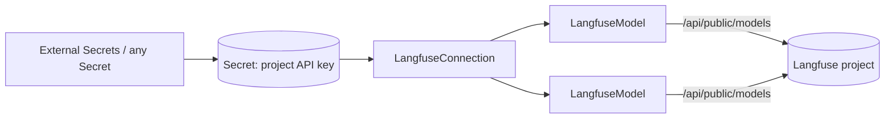

<p align="center">
  
</p>

<h1 align="center">langfuse-operator</h1>

<p align="center"><b>Langfuse configuration as code, for Kubernetes.</b></p>

A Kubernetes operator that manages [Langfuse](https://langfuse.com) configuration as
custom resources. It works with any self-hosted Langfuse v3 deployment, including the
official Helm chart. All it needs is a project API key.

The first resource is **`LangfuseModel`**: model definitions and pricing, kept in Git
and applied to Langfuse automatically. Generations whose model has no definition
show **$0 cost** in Langfuse. This operator closes that gap for:

- models Langfuse has not added yet, or added in a release you have not upgraded to;
- provider-specific IDs and prices, e.g. Amazon Bedrock regional (`us.`, `eu.`, `apac.`)
  inference profiles, which cost 10% more than the global profile;
- internal, fine-tuned or self-hosted models, and negotiated prices.

```yaml
apiVersion: langfuse.virtual-objects.github.io/v1alpha1
kind: LangfuseModel
metadata:
  name: claude-sonnet-4-6-bedrock-geo
spec:
  connectionRef: {name: my-project}
  modelName: claude-sonnet-4-6-bedrock-geo
  matchPattern: '(?i)^(us|eu|apac|au|jp)\.anthropic\.claude-sonnet-4-6(-v\d+:\d+)?$'
  tokenizerId: claude
  pricingTiers:
    - name: Standard
      isDefault: true
      pricePerMillion: {input: "3.30", output: "16.50", cacheRead: "0.33", cacheWrite: "4.125"}
```

```console
$ kubectl get lfmodel
NAME                            MODEL                           CONNECTION   READY   AGE
claude-sonnet-4-6-bedrock-geo   claude-sonnet-4-6-bedrock-geo   my-project   True    2m
```

## How it works



- **`LangfuseConnection`** is a host plus a Secret holding a project-scoped API key pair
  (`public_key`, `secret_key`). The operator checks the key and records the project.
  The Secret can come from anywhere, for example External Secrets Operator.
- **`LangfuseModel`** points at a connection in the same namespace. The operator creates
  the model through Langfuse's public API. Langfuse clears its model-match cache on
  every change, so new prices apply to new generations right away.

The operator uses only project-scoped public API endpoints, so it does **not** need a
Langfuse Enterprise license, an organization key, or database access.

### Reconciliation behaviour

| Situation | What the operator does |
|---|---|
| Model missing in Langfuse | Creates it. |
| A project model with the same `modelName` exists (e.g. made by hand) | Adopts it, then fixes any differences. |
| Spec changed, or someone edited/deleted the model in Langfuse | Detects the drift on the next resync (default 10 min) or immediately on a spec change. Langfuse v3 has no update endpoint, so the model is deleted and created again. Costs of already-ingested generations are not changed. |
| `modelName` changed | Deletes the model stored under the old name. |
| A built-in Langfuse model has the same name | Leaves it alone. The project model takes precedence in Langfuse. |
| Two `LangfuseModel`s manage the same `modelName` through the same connection | The older one wins; the newer one reports `Conflict`. |
| Resource deleted | Deletes the Langfuse model (`deletionPolicy: Delete`, the default) or keeps it (`Orphan`). If the connection is already gone, deletion is not blocked. |

Progress is reported in the `Ready` condition (`Synced`, `InvalidSpec`, `Rejected`,
`Unauthorized`, `SecretNotFound`, `ConnectionNotReady`, `Conflict`, `APIError`) and in
Kubernetes events (`kubectl describe lfmodel <name>`).

## Pricing

Prices are decimal strings in USD, so values like `0.33` are never rounded through a
float. Set them per million units (`pricePerMillion`) or per unit (`pricePerUnit`).

Keys are either **aliases** or **literal Langfuse usage types**. An alias expands to
every usage-type name that Langfuse and its SDKs report:

| Alias | Usage types |
|---|---|
| `input` | `input`, `input_tokens` |
| `output` | `output`, `output_tokens` |
| `cacheRead` | `input_cache_read`, `cache_read_input_tokens` |
| `cacheWrite` | `input_cache_creation`, `cache_creation_input_tokens` |
| `total` | `total` |

Any other key, e.g. `reasoning_tokens`, is passed through unchanged. Precedence, last
wins: `pricePerMillion` aliases, `pricePerMillion` literals, `pricePerUnit` aliases,
`pricePerUnit` literals.

Pricing tiers follow Langfuse's rules, enforced when you apply the resource:

- exactly one default tier (`isDefault: true`), with priority 0 and no conditions;
- every other tier has at least one condition;
- tier names and priorities are unique;
- every tier prices the same usage types.

See [`config/samples`](config/samples) for a tiered example.

## Install

**Helm** (from the GitHub Container Registry):

```sh
helm install langfuse-operator oci://ghcr.io/virtual-objects/charts/langfuse-operator \
  --version 0.1.0 --namespace langfuse-operator-system --create-namespace
```

**Plain manifests:**

```sh
kubectl apply -f https://github.com/virtual-objects/langfuse-operator/releases/download/v0.1.0/install.yaml
```

Release images are multi-arch (amd64/arm64) and signed with
[cosign](https://github.com/sigstore/cosign) keyless signing:

```sh
cosign verify ghcr.io/virtual-objects/langfuse-operator:v0.1.0 \
  --certificate-identity-regexp 'https://github.com/virtual-objects/langfuse-operator/.*' \
  --certificate-oidc-issuer https://token.actions.githubusercontent.com
```

### Quick start

1. In Langfuse, open **Project Settings → API Keys** and create a key pair.
2. Store it in a Secret with keys `public_key` and `secret_key`. Create it directly, or
   with External Secrets Operator ([example](config/samples/externalsecret.yaml)).
3. Apply a connection and a model:

```sh
kubectl apply -f config/samples/langfuse_v1alpha1_langfuseconnection.yaml   # edit host and keys first
kubectl apply -f config/samples/langfuse_v1alpha1_langfusemodel.yaml
kubectl get lfconn,lfmodel
```

**Day-to-day changes:** follow the
[runbook for adding or updating model definitions](docs/runbook-model-definitions.md).

Models belong to one Langfuse project. To price the same model in several projects,
create one connection per project and one `LangfuseModel` per connection; Kustomize
overlays work well for this.

### Operator flags

| Flag | Default | Purpose |
|---|---|---|
| `--resync-period` | `10m` | How often Ready objects are re-checked against Langfuse. |
| `--watch-namespaces` (env `WATCH_NAMESPACES`) | all | Comma-separated namespaces to watch. |
| `--leader-elect` | `false` (`true` in the shipped manifests) | Run several replicas safely. |

## Security

- **Secrets:** the operator needs only `get` on Secrets, not `list` or `watch`, and
  reads them without caching. A changed key is picked up on the next resync.
- **Namespaces:** `connectionRef` and `apiKeySecretRef` are same-namespace only, so a
  namespace can never use another namespace's credentials.
- **Data sent to Langfuse:** only model definitions. Secret values are never logged.
- **Requests:** every call carries `X-From: langfuse-operator` and a versioned
  `User-Agent`, so it can be identified in Langfuse logs.

Report vulnerabilities privately; see [SECURITY.md](SECURITY.md).

## Compatibility

| Component | Tested |
|---|---|
| Langfuse | 3.139 and the latest 3.x (3.227), in CI on every change |
| Kubernetes | 1.37 (envtest) and kind's default node image |

Langfuse Cloud exposes the same public API and should work, but it is not tested yet.

## Roadmap: Langfuse as code

`LangfuseConnection` and the shared reconcile helpers are built so more Langfuse
resources can be added with little code. [docs/automation.md](docs/automation.md)
shows the YAML for the proposed kinds, which Langfuse API each one uses, and a GitOps
layout for many environments:

| Kind | Status |
|---|---|
| `LangfuseConnection`, `LangfuseModel` | Available |
| `LangfuseScoreConfig`, `LangfusePrompt`, `LangfuseLLMConnection`, `LangfuseDataset` | Proposed |
| `LangfuseAnnotationQueue`, `LangfuseEvaluator` | Later |

To build one, follow [docs/extending.md](docs/extending.md). Ideas and pull requests
are welcome.

## Contributing

See [CONTRIBUTING.md](CONTRIBUTING.md). Everyday commands:

```sh
make test                                            # unit + envtest (fake Langfuse)
make lint
make test-e2e-langfuse LANGFUSE_VERSION=3.139        # kind + a real Langfuse in Docker
```

## License

[Apache License 2.0](LICENSE). Langfuse is a trademark of Langfuse GmbH. This project
is not affiliated with or endorsed by Langfuse.
