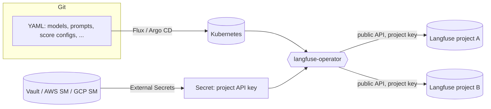

# Langfuse as code

`langfuse-operator` turns Langfuse project configuration into Kubernetes YAML. You keep
the YAML in Git; a GitOps tool such as Flux or Argo CD applies it to every environment;
the operator makes each Langfuse project match. Reviews, history and rollbacks come
from Git, and every environment gets the same configuration.



> **Status.** `LangfuseConnection`, `LangfuseModel` and `LangfuseCostAlert` are available today. The other
> kinds on this page are **proposals** that show how the operator extends. They are
> not implemented yet; their YAML may change. Comment on or open an issue to shape them.

## What every kind gets for free

Each kind is built on the same foundation (see [extending.md](extending.md)):

| Capability | How |
|---|---|
| Credentials | `connectionRef` to a `LangfuseConnection`; the key comes from a Secret, e.g. External Secrets. |
| Validation | Langfuse's own rules are mirrored as CRD schema and CEL rules, so mistakes fail at `kubectl apply` / PR CI. |
| Status | A `Ready` condition with a reason, `observedGeneration`, the remote ID, and Kubernetes events for every change. |
| Drift correction | Periodic re-check (`--resync-period`), so changes made in the Langfuse UI are put back. |
| Adoption | Existing objects with the same natural key (name) are taken over, not duplicated. |
| Deletion | A finalizer, plus `deletionPolicy: Delete \| Orphan`. |
| Security | Project-scoped public API only: no Enterprise license, no database access, same-namespace references. |

## Resource catalogue

| Kind | Status | Langfuse API | Lifecycle notes |
|---|---|---|---|
| `LangfuseConnection` | **Available** | `GET /api/public/projects` | Verifies the key and records the project. |
| `LangfuseModel` | **Available** | `/api/public/models` | No update endpoint in v3: changes are delete + create. |
| `LangfuseCostAlert` | **Available** | `/api/public/metrics` (read only) | Slack alerts on budget, spikes/drops, cost per run, unpriced models. See [cost-alerts.md](cost-alerts.md). |
| `LangfuseScoreConfig` | Proposed | `/api/public/score-configs` (`POST`, `PATCH`) | Cannot be deleted in Langfuse; deletion archives it (`isArchived: true`). |
| `LangfusePrompt` | Proposed | `/api/public/v2/prompts` | Versions are immutable: a content change creates a new version, then labels such as `production` are moved to it. Delete removes the prompt. |
| `LangfuseLLMConnection` | Proposed | `/api/public/llm-connections` (`PUT` upsert, `DELETE`) | Provider key comes from a Secret and is never stored in the CR. Used by the playground and LLM-as-a-judge. |
| `LangfuseDataset` | Proposed | `/api/public/v2/datasets`, `/api/public/dataset-items` | Datasets cannot be deleted through the API (orphaned on delete); items are upserted by ID. |
| `LangfuseAnnotationQueue` | Proposed | `/api/public/annotation-queues` | Create-only in v3 public API. |
| `LangfuseEvaluator` | Later | `/api/public/unstable/evaluators`, `evaluation-rules` | Exists only in newer Langfuse releases and is marked unstable; waits for a stable API. |

## Today: models and pricing

```yaml
apiVersion: langfuse.virtual-objects.github.io/v1alpha1
kind: LangfuseConnection
metadata: {name: chat-agent}
spec:
  host: http://langfuse-web.langfuse.svc:3000
  apiKeySecretRef: {name: chat-agent-langfuse-keys}   # from External Secrets
---
apiVersion: langfuse.virtual-objects.github.io/v1alpha1
kind: LangfuseModel
metadata: {name: claude-sonnet-4-6-bedrock-geo}
spec:
  connectionRef: {name: chat-agent}
  modelName: claude-sonnet-4-6-bedrock-geo
  matchPattern: '(?i)^(us|eu|apac|au|jp)\.anthropic\.claude-sonnet-4-6(-v\d+:\d+)?$'
  tokenizerId: claude
  pricingTiers:
    - name: Standard
      isDefault: true
      pricePerMillion: {input: "3.30", output: "16.50", cacheRead: "0.33", cacheWrite: "4.125"}
```

Step-by-step instructions for adding, repricing or removing models are in the
[model definition runbook](runbook-model-definitions.md).

## Proposed kinds

### LangfuseScoreConfig: one scoring scheme everywhere

```yaml
apiVersion: langfuse.virtual-objects.github.io/v1alpha1
kind: LangfuseScoreConfig
metadata: {name: answer-correctness}
spec:
  connectionRef: {name: chat-agent}
  name: answer-correctness
  description: Is the answer factually correct for the question?
  dataType: CATEGORICAL          # NUMERIC | CATEGORICAL | BOOLEAN | TEXT
  categories:
    - {label: incorrect, value: 0}
    - {label: partially-correct, value: 0.5}
    - {label: correct, value: 1}
  deletionPolicy: Delete         # archives the config in Langfuse
```

### LangfusePrompt: reviewed prompts promoted by label

```yaml
apiVersion: langfuse.virtual-objects.github.io/v1alpha1
kind: LangfusePrompt
metadata: {name: support-agent-system}
spec:
  connectionRef: {name: chat-agent}
  name: support-agent/system
  type: chat                     # text | chat
  labels: [production]           # moved to the new version after each change
  tags: [support]
  prompt:
    - role: system
      content: |
        You are a network support assistant. Answer using {{site_name}} context only.
  config:
    model: claude-sonnet-4-6
    temperature: 0.2
  commitMessage: Tighten scope to site context
```

Because versions are immutable, the operator would create a version only when the
rendered content differs from the version that carries the managed label. Staging can
use `labels: [staging]` through a Kustomize overlay while production keeps
`[production]`.

### LangfuseLLMConnection: playground and judge credentials without UI clicks

```yaml
apiVersion: langfuse.virtual-objects.github.io/v1alpha1
kind: LangfuseLLMConnection
metadata: {name: bedrock}
spec:
  connectionRef: {name: chat-agent}
  provider: bedrock
  adapter: bedrock
  secretKeyRef: {name: bedrock-llm-credentials, key: credentials}   # never inline
  config: {region: us-east-1}
  customModels: [anthropic.claude-sonnet-4-6]
  withDefaultModels: false
```

### LangfuseDataset: evaluation sets reviewed in Git

```yaml
apiVersion: langfuse.virtual-objects.github.io/v1alpha1
kind: LangfuseDataset
metadata: {name: wifi-troubleshooting-golden}
spec:
  connectionRef: {name: chat-agent}
  name: wifi-troubleshooting-golden
  description: Golden questions for regression tests
  items:
    - id: dhcp-timeout-01         # stable ID, upserted
      input: {question: "Clients get no IP on SSID guest"}
      expectedOutput: {rootCause: "DHCP scope exhausted"}
  # or, for large sets:
  # itemsFrom: {configMapRef: {name: wifi-golden-items, key: items.jsonl}}
  deletionPolicy: Orphan          # datasets cannot be deleted via the API
```

## Putting it together: one bundle, many environments

A typical GitOps layout keeps the shared definitions in a base and only the
connection (host and Secret) per environment:

```text
langfuse/
  base/
    kustomization.yaml
    models/claude-sonnet-4-6-bedrock-geo.yaml
    score-configs/answer-correctness.yaml     # when available
    prompts/support-agent-system.yaml         # when available
  overlays/
    staging/
      kustomization.yaml        # resources: ../../base, connection.yaml, externalsecret.yaml
      connection.yaml           # host: http://langfuse-web.langfuse.svc:3000
      externalsecret.yaml       # staging project key
    production/
      kustomization.yaml
      connection.yaml
      externalsecret.yaml
      prompt-labels-patch.yaml  # e.g. promote prompts to "production"
```

```yaml
# overlays/production/kustomization.yaml
apiVersion: kustomize.config.k8s.io/v1beta1
kind: Kustomization
namespace: langfuse-config
resources:
  - ../../base
  - connection.yaml
  - externalsecret.yaml
```

All resources in the base reference `connectionRef: {name: chat-agent}`, so the same
files apply to every environment, and each overlay decides which Langfuse instance and
project they land in. For several projects, add one connection and one namespace (or
name suffix) per project.

## Want a kind sooner?

Open a feature request with the YAML you would like to write, or follow
[extending.md](extending.md) to contribute it.
